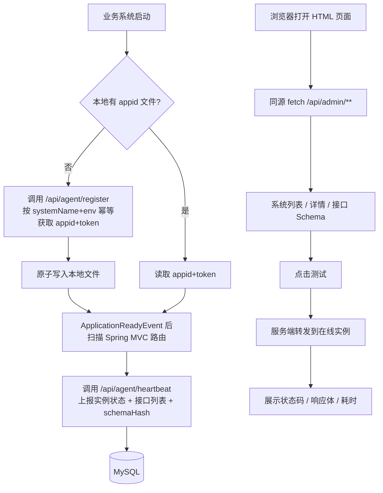

# 系统管理平台实施方案

## 1. 目标

为数百个 Java/Spring 系统提供统一管理平台：

- 服务端展示系统列表，点击进入详情页。
- 详情页展示每个系统上报的接口、输入输出 Schema，并支持在线测试。
- 各系统引入客户端 SDK 后，启动时与服务端通信：首次获取唯一 appid 并存入本地文件；随后上报接口列表与在线状态。

## 2. 技术选型（已确认）

| 项     | 选择                                                              |
|-------|-----------------------------------------------------------------|
| 服务端   | Spring Boot 3.x 单体                                              |
| 持久层   | MyBatis-Plus                                                    |
| 数据库   | MySQL，连接 `jdbc:mysql://localhost:3306/test`                     |
| 管理页面  | 原生 HTML + JS，放在 `app-service-server/src/main/resources/static/` |
| 客户端   | Java Spring Boot Starter                                        |
| 接口元数据 | SDK 自动扫描 Spring MVC 路由并生成 JSON Schema                           |
| 测试链路  | 服务端转发到已注册实例                                                     |
| 安全    | 不做密钥、不做登录，内网使用                                                  |
| 扫描范围  | 仅 Spring MVC，不含 Feign/Dubbo                                     |

## 3. 模块结构

```text
app-service/
├── pom.xml                              (parent, packaging=pom)
├── app-service-common/                  (协议 DTO、常量)
├── app-sdk-spring-boot-starter/         (业务系统引入的客户端)
└── app-service-server/                  (Spring Boot 单体 + 管理页面)
    ├── src/main/java/...
    └── src/main/resources/
        ├── application.yml
        ├── db/schema.sql
        └── static/
            ├── index.html
            ├── app-detail.html
            ├── css/app.css
            └── js/
                ├── common.js
                ├── app.js
                └── test.js
```

## 4. 核心流程



## 5. API 设计

### Agent 侧（SDK 调用）

| 方法   | 路径                     | 说明                                                  |
|------|------------------------|-----------------------------------------------------|
| POST | `/api/agent/register`  | 按 `(systemName, env)` 幂等分配 appid，返回 `appId`、`token` |
| POST | `/api/agent/heartbeat` | 上报实例信息、在线状态、接口列表、`schemaHash`                       |

### Admin 侧（HTML 页面调用）

| 方法   | 路径                                   | 说明                                      |
|------|--------------------------------------|-----------------------------------------|
| GET  | `/api/admin/apps`                    | 系统列表：名称、环境、在线实例数、接口数、最近心跳               |
| GET  | `/api/admin/apps/{appId}`            | 系统详情 + 实例列表                             |
| GET  | `/api/admin/apps/{appId}/interfaces` | 接口列表，含 `requestSchema`/`responseSchema` |
| POST | `/api/admin/apps/{appId}/test`       | 测试转发，返回状态码、响应头、响应体、耗时                   |

## 6. 数据库设计

`schema.sql` 使用 `CREATE TABLE IF NOT EXISTS`，启动自动初始化。

| 表               | 关键字段                                                                                                                                                       |
|-----------------|------------------------------------------------------------------------------------------------------------------------------------------------------------|
| `app`           | `id`, `app_id`(唯一), `name`, `env`, `token`, `interfaces_hash`, `created_at`, `updated_at`                                                                  |
| `app_instance`  | `id`, `app_id`, `instance_key`, `ip`, `port`, `hostname`, `status`, `last_heartbeat_at`, `start_time`                                                      |
| `api_interface` | `id`, `app_id`, `method`, `path`, `controller`, `operation`, `request_schema`, `response_schema`, `schema_hash`, `updated_at`，唯一键 `(app_id, method, path)` |
| `test_log`      | `id`, `app_id`, `interface_id`, `request_summary`, `response_status`, `cost_ms`, `created_at`                                                              |

状态判定：心跳默认 30 秒一次，超过 3 个周期（90 秒）未上报则置为 `OFFLINE`。

## 7. SDK 设计

配置前缀：`app.registry.*`

| 配置项                  | 默认值                                       | 说明             |
|----------------------|-------------------------------------------|----------------|
| `server-url`         | 无                                         | 管理服务端地址        |
| `system-name`        | `${spring.application.name}`              | 系统名称           |
| `env`                | `default`                                 | 环境标识           |
| `appid-file`         | `~/.app-service/{systemName}-{env}.appid` | 本地 appid 文件    |
| `advertise-ip`       | 自动探测                                      | 上报给服务端的业务系统 IP |
| `heartbeat-interval` | `30s`                                     | 心跳间隔           |
| `exclude-paths`      | `/actuator/**,/error`                     | 不采集的路径         |

行为：

- 注册按 `(systemName, env)` 幂等；本地文件丢失可取回原 appid。
- 文件写入采用临时文件 + 原子移动，避免半写。
- 注册失败不阻塞业务系统启动，后台按退避策略重试。
- `ApplicationReadyEvent` 后扫描 `RequestMappingHandlerMapping`。
- 提取 HTTP 方法、路径、参数注解、DTO 字段结构，生成 JSON Schema。
- 用 `schemaHash` 对比，服务端无变化则不更新 schema。
- 心跳失败只记录日志，不影响业务系统。

## 8. 管理页面

原生 HTML + JS，无构建步骤：

- `index.html`：系统列表、搜索、状态筛选。
- `app-detail.html`：系统信息、实例列表、接口列表、Schema 折叠展示、测试面板。
- `common.js`：fetch 封装。
- `app.js`：列表与详情逻辑。
- `test.js`：测试请求与响应展示。

## 9. 测试转发约束

- 目标地址只能来自已注册实例的 `advertiseIp:port`，不接受任意 URL，防止 SSRF。
- 连接超时 3 秒，读取超时 10 秒，响应体最大 1MB。
- 每次测试写入 `test_log`。

## 10. 实施步骤

1. 父 `pom.xml` + 三个子模块骨架。
2. `app-service-common`：注册/心跳/接口元数据 DTO 与常量。
3. `app-service-server`：MySQL 配置、MyBatis-Plus、`schema.sql`、Agent API。
4. `app-service-server`：Admin API 与测试代理。
5. `app-service-server`：静态 HTML/JS 页面。
6. `app-sdk-spring-boot-starter`：自动配置、注册、本地文件、心跳、接口扫描。
7. 本地联调：启动 server → 启动示例业务系统 → 验证列表/详情/测试。
8. README：接入方式与配置项说明。

## 11. 后续可扩展

- 注册密钥与管理端登录。
- Feign/Dubbo 接口采集。
- 客户端反向通道，支持内网无入站端口的系统。
- Flyway 管理表结构版本。
- 影子数据库与多步骤业务链路 Session。
- MQ / Redis / 文件系统 Mock。

## 12. 流量录制与 Dry-Run 回放（第一期）

### 12.1 目标

在真实调用业务接口的前提下，让写接口可以在测试环境“执行一次但不落库”，并让外部 HTTP 调用返回录制到的 Mock 响应。详细设计见 `docs/DESIGN_TRAFFIC_RECORDING_AND_DRYRUN_REPLAY.md`。

### 12.2 新增表

| 表 | 用途 |
|---|---|
| `traffic_record` | 入站 HTTP 流量采样结果 |
| `external_call_record` | RestTemplate 出站调用记录，作为 Mock 数据来源 |
| `mock_response` | Mock 规则，按 `requestHash` 匹配 |
| `api_interface.write_operation` | 接口写操作标记 |
| `test_log` 扩展 | `replay_id`、`replay_mode`、`db_rolled_back`、`mock_hits`、`mock_misses` |

### 12.3 关键链路

1. SDK `TrafficCaptureFilter` 采集入站请求/响应，按采样率、include/exclude、脱敏和截断规则写入有界队列。
2. SDK `OutboundHttpRecordingInterceptor` 在正常模式记录 RestTemplate 出站调用。
3. `TrafficReporter` 按 `batch-size` / `flush-interval` 批量上报；失败只记日志并丢弃该批，队列有界不会无限堆积。
4. 管理端把流量关联到 `api_interface`，页面提供筛选、详情与 Dry-Run 入口。
5. `TestProxyService` 生成 `replayId`、`timestamp`、`nonce` 和 HMAC 签名，携带 `X-App-Replay*` Header 真实调用业务实例。
6. SDK `ReplayFilter` 校验签名、时间窗与 nonce，用 `TransactionTemplate` 包裹 Filter Chain 并在结束时设置 `rollbackOnly`。
7. SDK `ReplayRestTemplateInterceptor` 回放时只返回 Mock 响应；未命中直接抛 `ReplayMockMissingException`，不发起真实调用。
8. 回放结果写入 `TestResultVO` 与 `test_log`，统计按 `replayMode` 区分真实测试和 Dry-Run。

### 12.4 风险边界

- 仅事务回滚，不是影子库；写入必须在同一事务管理器内。
- 多步骤链路暂不支持；异步线程数据库写入不在第一期保证范围。
- MQ / Redis / 文件 Mock 暂不支持，HTTP Mock 仅覆盖 RestTemplate。
- 生产环境默认关闭；回放开关关闭时收到回放 Header 返回 403。
- `REQUIRES_NEW` 会脱离外层事务，Service 不应使用；SDK 启动时扫描并告警。
- Mock 未命中必须失败，不能静默回退真实外部调用。

### 12.5 联调验证

demo-order-service 提供 `POST /api/orders/dryrun-demo`：内部调用 product-service 并写入 `demo_order_audit` 表。按 README 生成 Mock 并回放后，应确认：业务响应正常、`dbRolledBack=true`、Mock 命中数增加、审计表计数不变；禁用 Mock 后回放失败且真实外部接口未被调用。
