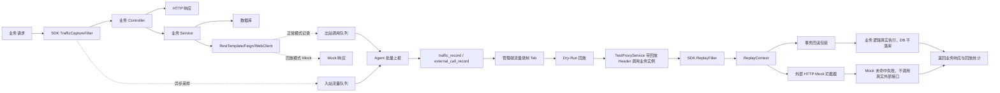

# 流量录制与 Dry-Run 回放设计说明书

| 项目 | 内容 |
|---|---|
| 版本 | v1.0 |
| 日期 | 2026-11-25 |
| 状态 | 待实现 |
| 适用范围 | 第一阶段：流量录制 + Dry-Run 回放 |
| 目标系统 | app-service 管理端、app-sdk-spring-boot-starter、demo-product-service、demo-order-service |

## 1. 背景与目标

当前系统已经具备：

1. 业务系统通过 SDK 自动注册、心跳上报在线状态。
2. SDK 扫描 Spring MVC 路由并上报接口元数据与 Schema。
3. 管理端可在线测试接口，并保存、去重、回放测试用例。
4. SDK 已有 `ControllerLogAspect`，通过 AOP + 反射记录 Controller 输入输出日志。
5. 管理端已有测试统计，数据来自 `test_log` 表。

当前缺口：

1. 真实业务流量没有被集中采集。
2. 回放会真实调用业务接口，若接口含 INSERT / UPDATE / DELETE，会真实写库。
3. 业务系统对外 HTTP 调用没有 Mock 能力。
4. Mock 未命中时没有失败保护，存在误调用真实外部系统的风险。

本阶段目标：

1. SDK 采集入站 HTTP 流量并批量上报管理端。
2. SDK 采集出站 HTTP 调用，作为外部接口 Mock 数据来源。
3. 管理端支持查看录制流量并选择流量进行 Dry-Run 回放。
4. Dry-Run 回放仍然真实调用业务系统接口。
5. Dry-Run 回放期间：
   - 数据库写入整体回滚，不真正落库；
   - 外部 HTTP 调用返回 Mock 数据；
   - Mock 未命中时请求失败，绝不退回真实外部调用。
6. 回放结果中明确展示：是否回放模式、数据库是否回滚、Mock 命中数、Mock 未命中数。

## 2. 本期范围

### 2.1 本期包含

1. 入站 HTTP 流量录制。
2. 出站 HTTP 调用录制，限定 RestTemplate / Feign / WebClient 中的至少 RestTemplate，其余按实现进度补充。
3. 管理端 Agent 批量上报接口。
4. `traffic_record`、`external_call_record`、`mock_response` 表。
5. 流量录制管理页面 Tab。
6. Dry-Run 回放请求头与 SDK 回放上下文。
7. SDK 回放事务回滚。
8. SDK 外部 HTTP Mock 拦截器。
9. Mock 未命中失败。
10. `test_log` 增加回放与 Mock 统计字段。
11. demo 服务联调验证。

### 2.2 本期不包含

1. 影子数据库。
2. 多步骤业务链路 Session。
3. 虚拟 ID 映射。
4. MQ、Redis、文件系统的完整 Mock 体系。
5. 管理端登录鉴权，作为安全前置项另行评估。
6. 生产环境默认开启回放能力。

## 3. 总体架构



## 4. 关键流程

### 4.1 流量录制流程

1. 请求进入 SDK `TrafficCaptureFilter`。
2. 判断是否满足采样条件：
   - 开关是否开启；
   - 是否命中 include / exclude path；
   - 是否命中采样率；
   - 是否只记录错误请求；
   - Body 是否超过大小限制。
3. 读取并记录：
   - method、path、query、header、body；
   - traceId；
   - instanceKey；
   - 请求时间。
4. 请求继续执行业务 Controller。
5. 响应返回时记录：
   - responseStatus；
   - responseBody 截断结果；
   - costMs；
   - success / error。
6. 脱敏后写入有界内存队列。
7. 后台线程按 `batch-size` + `flush-interval` 批量上报管理端。
8. 上报失败只记日志，不影响业务请求。
9. 队列满时丢弃并记录 dropped 计数。

### 4.2 出站 HTTP 调用录制流程

1. 正常模式下，RestTemplate / Feign / WebClient 拦截器记录外部调用请求与响应。
2. 生成 requestHash：
   - method；
   - URL，必要的动态参数归一化；
   - 排序后的 query；
   - 脱敏后的 body。
3. 写入 `external_call_record`。
4. 回放时优先按相同 requestHash 查找 Mock 响应。

### 4.3 Dry-Run 回放流程

1. 管理端选择一条录制流量，点击 Dry-Run 回放。
2. `TestProxyService` 仍真实调用业务实例。
3. 请求携带回放 Header：
   - `X-App-Replay: true`
   - `X-App-Replay-Id`
   - `X-App-Replay-Mode: DRY_RUN`
   - `X-App-Replay-Timestamp`
   - `X-App-Replay-Nonce`
   - `X-App-Replay-Signature`
4. SDK `ReplayFilter` 校验：
   - 回放开关是否打开；
   - 签名是否正确；
   - timestamp 是否过期；
   - nonce 是否重复。
5. 校验通过后创建 `ReplayContext`。
6. `ReplayFilter` 开启事务，并用 `TransactionTemplate` 包裹后续 Filter Chain。
7. 业务 Controller / Service 正常执行。
8. 数据库 SELECT 正常执行；INSERT / UPDATE / DELETE 在同一事务内执行但最后回滚。
9. 出站 HTTP 调用被 Mock 拦截器接管：
   - 命中 Mock：返回 Mock 响应；
   - 未命中 Mock：抛出 `ReplayMockMissingException`。
10. Filter Chain 结束后设置 `rollbackOnly` 并回滚事务。
11. 响应返回管理端。
12. 管理端写入 `test_log`，标记 replayMode、mockHits、mockMisses、dbRolledBack。

## 5. 模块设计

### 5.1 app-service-common

新增 DTO：

1. `TrafficRecordDTO`
2. `TrafficBatchDTO`
3. `ExternalCallRecordDTO`
4. `ReplayMode` 枚举：
   - `NONE`
   - `DRY_RUN`
5. `TestResultVO` 扩展字段：
   - `replayId`
   - `replayMode`
   - `dbRolledBack`
   - `mockHits`
   - `mockMisses`

### 5.2 app-sdk-spring-boot-starter

#### 5.2.1 配置属性

在 `AppRegistryProperties` 下增加：

```yaml
app:
  registry:
    traffic-record:
      enabled: false
      sample-rate: 0.05
      only-errors: false
      include-paths:
        - /api/**
      exclude-paths:
        - /actuator/**
        - /error
      max-body-bytes: 4096
      mask-headers:
        - Authorization
        - Cookie
        - Set-Cookie
        - X-Token
      mask-fields:
        - password
        - token
        - phone
        - idCard
      batch-size: 100
      flush-interval: 5s
      queue-size: 10000
    external-call-record:
      enabled: false
      max-body-bytes: 4096
      mask-fields:
        - password
        - token
    replay:
      enabled: false
      db-strategy: rollback
      mock-missing-policy: fail
      signature-enabled: true
      max-timestamp-skew: 5m
```

#### 5.2.2 新增类

| 类 | 职责 |
|---|---|
| `TrafficCaptureFilter` | 采集入站 HTTP 请求与响应 |
| `OutboundHttpRecordingInterceptor` | 正常模式下录制 RestTemplate 外部调用 |
| `TrafficRecordBuffer` | 有界队列、批量刷新、丢弃计数 |
| `TrafficReporter` | 批量上报管理端 |
| `ReplayFilter` | 校验回放 Header，创建上下文，开启回滚事务 |
| `ReplayContext` | ThreadLocal 保存回放信息 |
| `ReplayInfo` | replayId、mode、timestamp、nonce 等 |
| `ReplaySignatureUtil` | HMAC 签名与校验 |
| `ReplayRestTemplateInterceptor` | 回放模式下返回 Mock 响应 |
| `MockResponseStore` | 从服务端或本地缓存查询 Mock 响应 |
| `MockClientHttpResponse` | 构造模拟响应 |
| `ReplayMockMissingException` | Mock 未命中异常 |
| `ReplayTaskDecorator` | 异步线程上下文传播 |

#### 5.2.3 数据库事务回滚

第一版使用外层事务回滚：

1. `ReplayFilter` 从 Spring 容器获取 `PlatformTransactionManager`。
2. 使用 `TransactionTemplate` 包裹 `filterChain.doFilter`。
3. 在 finally 中调用 `status.setRollbackOnly()`。
4. 业务 Service 默认 `@Transactional(REQUIRED)` 会加入外层事务。
5. 回放结束后统一回滚。

必须约束：

1. 业务 Service 不应使用 `REQUIRES_NEW`。
2. 数据库写入必须在同一个 DataSource / TransactionManager 中。
3. 异步线程中的数据库写入不在第一版保证范围内。
4. 返回对象应在事务回滚前完成 DTO 化，避免延迟加载失败。

### 5.3 app-service-server

#### 5.3.1 新增 Agent 接口

```text
POST /api/agent/traffic/records
POST /api/agent/external-call/records
GET  /api/admin/interfaces/{interfaceId}/mock-responses
POST /api/admin/mock-responses
```

批量上报请求示例：

```json
{
  "appId": "APP-PRODUCT-DEMO-0001",
  "token": "product-demo-token",
  "records": [
    {
      "traceId": "b1b6...",
      "method": "POST",
      "path": "/api/products",
      "queryParams": "{}",
      "headers": "{\"Content-Type\":\"application/json\"}",
      "body": "{\"name\":\"test\"}",
      "responseStatus": 200,
      "responseBody": "{\"code\":0,\"message\":\"ok\"}",
      "costMs": 35,
      "success": true,
      "createdAt": "2026-11-25T10:00:00"
    }
  ]
}
```

#### 5.3.2 新增 Service

| Service | 职责 |
|---|---|
| `TrafficRecordService` | 入站流量落库、查询、接口关联 |
| `ExternalCallRecordService` | 出站调用落库、查询、生成 Mock 数据 |
| `MockResponseService` | Mock 规则增删改查、按 requestHash 查询 |
| `ReplayHeaderService` | 构造回放 Header、生成签名 |

#### 5.3.3 TestProxyService 扩展

`TestRequest` 增加：

```java
private String replayMode;
private Long trafficRecordId;
private String mockResponseId;
```

`test()` 保持真实调用业务实例，但在 replayMode 为 `DRY_RUN` 时：

1. 生成 replayId。
2. 生成 timestamp、nonce、signature。
3. 添加回放 Header。
4. 调用完成后把 mockHits / mockMisses / dbRolledBack 写入响应与日志。

### 5.4 管理端前端

在 `app-detail.html` 的 Tab 中新增：

```text
接口列表 | 测试用例列表 | 流量录制
```

流量录制页面包含：

1. 时间范围筛选。
2. 接口筛选。
3. 方法筛选。
4. 状态码筛选。
5. 只看失败请求。
6. traceId 搜索。
7. 请求/响应详情。
8. `Dry-Run 回放` 按钮。
9. 回放结果展示：
   - 业务响应；
   - 是否 Dry-Run；
   - 数据库是否回滚；
   - Mock 命中数；
   - Mock 未命中数；
   - 错误原因。

## 6. 数据模型

```sql
CREATE TABLE IF NOT EXISTS traffic_record (
    id BIGINT PRIMARY KEY AUTO_INCREMENT,
    app_id VARCHAR(64) NOT NULL,
    interface_id BIGINT,
    instance_key VARCHAR(255),
    trace_id VARCHAR(128),
    method VARCHAR(16) NOT NULL,
    path VARCHAR(512) NOT NULL,
    query_params TEXT,
    headers TEXT,
    body TEXT,
    response_status INT,
    response_body TEXT,
    cost_ms BIGINT,
    success TINYINT NOT NULL DEFAULT 1,
    error TEXT,
    request_hash VARCHAR(64),
    created_at DATETIME NOT NULL,
    KEY idx_traffic_app_time (app_id, created_at),
    KEY idx_traffic_interface_time (interface_id, created_at),
    KEY idx_traffic_trace (trace_id),
    KEY idx_traffic_hash (request_hash)
) ENGINE=InnoDB DEFAULT CHARSET=utf8mb4;

CREATE TABLE IF NOT EXISTS external_call_record (
    id BIGINT PRIMARY KEY AUTO_INCREMENT,
    app_id VARCHAR(64) NOT NULL,
    trace_id VARCHAR(128),
    method VARCHAR(16) NOT NULL,
    url VARCHAR(1024) NOT NULL,
    request_headers TEXT,
    request_body TEXT,
    response_status INT,
    response_headers TEXT,
    response_body TEXT,
    cost_ms BIGINT,
    request_hash VARCHAR(64) NOT NULL,
    created_at DATETIME NOT NULL,
    KEY idx_external_app_time (app_id, created_at),
    KEY idx_external_trace (trace_id),
    KEY idx_external_hash (request_hash)
) ENGINE=InnoDB DEFAULT CHARSET=utf8mb4;

CREATE TABLE IF NOT EXISTS mock_response (
    id BIGINT PRIMARY KEY AUTO_INCREMENT,
    app_id VARCHAR(64) NOT NULL,
    interface_id BIGINT,
    method VARCHAR(16) NOT NULL,
    url_pattern VARCHAR(1024) NOT NULL,
    match_mode VARCHAR(16) NOT NULL DEFAULT 'EXACT',
    request_hash VARCHAR(64),
    mock_status INT NOT NULL DEFAULT 200,
    mock_headers TEXT,
    mock_body TEXT,
    enabled TINYINT NOT NULL DEFAULT 1,
    created_at DATETIME NOT NULL,
    updated_at DATETIME NOT NULL,
    KEY idx_mock_app_hash (app_id, request_hash),
    KEY idx_mock_app_interface (app_id, interface_id)
) ENGINE=InnoDB DEFAULT CHARSET=utf8mb4;

ALTER TABLE api_interface ADD COLUMN write_operation TINYINT NOT NULL DEFAULT 0;

ALTER TABLE test_log
ADD COLUMN replay_id VARCHAR(64),
ADD COLUMN replay_mode VARCHAR(16) NOT NULL DEFAULT 'NONE',
ADD COLUMN db_rolled_back TINYINT NOT NULL DEFAULT 0,
ADD COLUMN mock_hits INT NOT NULL DEFAULT 0,
ADD COLUMN mock_misses INT NOT NULL DEFAULT 0;
```

## 7. 接口契约

### 7.1 Dry-Run 回放请求

```text
POST /api/admin/apps/{appId}/test
```

Body：

```json
{
  "interfaceId": 25,
  "pathParams": {},
  "queryParams": {},
  "headers": {},
  "body": "{}",
  "replayMode": "DRY_RUN",
  "trafficRecordId": 1024
}
```

### 7.2 回放响应扩展

```json
{
  "code": 0,
  "message": "ok",
  "data": {
    "status": 200,
    "headers": {},
    "body": "{\"code\":0,\"message\":\"ok\",\"data\":{\"id\":1001}}",
    "costMs": 48,
    "replayId": "RP-20261125-0001",
    "replayMode": "DRY_RUN",
    "dbRolledBack": true,
    "mockHits": 2,
    "mockMisses": 0
  }
}
```

Mock 未命中时：

```json
{
  "code": 1,
  "message": "回放失败：外部调用 Mock 未命中，已阻止真实调用",
  "data": null
}
```

## 8. 安全与脱敏

1. 回放 Header 必须签名，防止伪造 Dry-Run 请求。
2. timestamp 超过允许时间窗直接拒绝。
3. nonce 需要短期去重，防止重放。
4. Header 默认脱敏：
   - Authorization
   - Cookie
   - Set-Cookie
   - X-Token
5. Body 字段默认脱敏：
   - password
   - token
   - phone
   - idCard
6. 录制 Body 和响应 Body 必须截断，默认 4KB。
7. 二进制、文件上传、大响应默认跳过。
8. `app.registry.replay.enabled` 默认 false。
9. 生产环境不应开启回放模式。

## 9. 失败策略

| 场景 | 策略 |
|---|---|
| 流量上报失败 | 只记录 SDK 日志，不影响业务 |
| 队列满 | 丢弃新样本，增加 dropped 计数 |
| 回放签名失败 | 返回 403 |
| 回放模式未开启 | 返回 403 |
| 外部 Mock 未命中 | 抛异常，禁止真实调用 |
| 数据库事务回滚失败 | 回放结果标记失败并记录错误 |
| Service 使用 REQUIRES_NEW | 回放前检测配置并给出警告 |
| 异步线程未传播上下文 | 第一版不保证，文档中明确限制 |

## 10. 测试方案

### 10.1 单元测试

1. `ReplaySignatureUtil` 签名与校验。
2. `TrafficCaptureFilter` 采样与脱敏。
3. `MockSignature` 生成一致性。
4. `MockResponseStore` 命中与未命中。
5. `TestProxyService` 回放 Header 构造。
6. `TrafficRecordService` interfaceId 关联。

### 10.2 集成测试

使用 demo-product-service 与 demo-order-service：

1. 启动管理端和两个 demo 服务。
2. demos 开启流量录制。
3. 调用 GET /api/products，确认 `traffic_record` 有记录。
4. 调用 POST /api/orders，确认业务库新增订单。
5. 对 POST 录制流量执行 Dry-Run 回放。
6. 确认：
   - 业务接口确实被调用；
   - Service 逻辑执行；
   - 数据库没有新增订单；
   - 外部 HTTP 调用返回 Mock 数据；
   - Mock 未命中场景失败；
   - `test_log` 正确记录 replayMode、mockHits、mockMisses。

## 11. 后续演进

1. 影子数据库支持多步骤链路。
2. 虚拟 ID 映射。
3. MQ / Redis / 文件系统 Mock。
4. 管理端 Mock 规则可视化编辑。
5. 流量录制数据保留与清理任务。
6. 管理端登录鉴权。
7. 回放前后的数据库差异对比报告。
