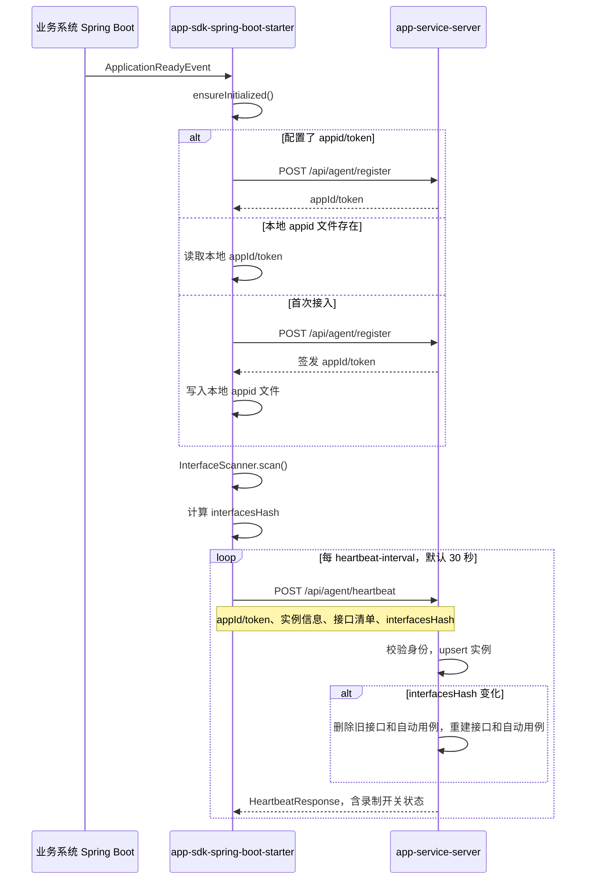

# SDK 业务系统与接口注册流程

本文说明 `app-sdk-spring-boot-starter` 如何处理新业务系统接入、实例注册、身份凭据保存、接口扫描与接口变更上报。

## 1. 一句话结论

SDK 的注册流程分成两条线：

1. **业务系统注册**：启动时调用 `/api/agent/register`，获取或恢复 `appId/token`，用于后续身份鉴权。
2. **接口注册**：接口不通过注册接口单独上报，而是在心跳中随实例信息一起上报；管理端比较 `interfacesHash`，发现变化后全量重建接口和自动用例。

核心入口是 `HeartbeatScheduler`：

- 应用就绪后执行首次注册和心跳；
- 之后按 `app.registry.heartbeat-interval` 定时心跳；
- 心跳响应同时携带录制开关状态，作为管理端实时下发失败时的兜底同步通道。

## 2. 适用范围与启用条件

当前实现基于 Spring Boot 3.x Servlet MVC：

- 接口扫描依赖 `RequestMappingHandlerMapping`；
- Filter 和 ThreadLocal 上下文依赖 `jakarta.servlet`；
- 不支持 WebFlux 开箱即用。

自动装配条件是 Web 应用且配置了 `app.registry.server-url`：

```java

@AutoConfiguration
@EnableScheduling
@ConditionalOnWebApplication
@ConditionalOnProperty(prefix = "app.registry", name = "server-url")
public class AppRegistryAutoConfiguration {
}
```

对应源码：
`app-sdk-spring-boot-starter/src/main/java/com/example/appservice/sdk/config/AppRegistryAutoConfiguration.java:32-39`。

最小配置示例：

```yaml
app:
  registry:
    server-url: http://localhost:8080
    system-name: demo-order-service
    env: dev
    advertise-ip: 127.0.0.1
    heartbeat-interval: 30s
    exclude-paths:
      - /actuator/**
      - /error
```

`appid` 和 `token` 可以不配置，首次启动时由管理端签发并保存到本地凭据文件。

## 3. 总体时序



## 4. 关键类与职责

| 类                              | 位置                              | 职责                                                   |
|--------------------------------|---------------------------------|------------------------------------------------------|
| `AppRegistryAutoConfiguration` | `sdk.config`                    | 自动装配注册、心跳、接口扫描等 Bean                                 |
| `HeartbeatScheduler`           | `sdk.registry`                  | 启动注册、定时心跳、接口 hash 计算、录制状态同步                          |
| `AppRegistryClient`            | `sdk.registry`                  | 调用管理端 `/api/agent/register` 和 `/api/agent/heartbeat` |
| `InterfaceScanner`             | `sdk.registry`                  | 扫描 Spring MVC 路由并生成接口元数据与 Schema                     |
| `AppIdentityResolver`          | `sdk.registry`                  | 解析 `appId/token`，配置优先、本地文件兜底                         |
| `AppIdFileStore`               | `sdk.registry`                  | 本地凭据文件读写，原子写入和权限收敛                                   |
| `AgentController`              | `app-service-server/controller` | 接收注册和心跳请求                                            |
| `AppService`                   | `app-service-server/service`    | 应用幂等注册、鉴权、实例 upsert、接口重建                             |

## 5. 新业务系统注册

### 5.1 启动触发

`HeartbeatScheduler.onReady()` 监听 `ApplicationReadyEvent`，应用启动完成后立即执行：

1. `ensureInitialized()`：准备身份、实例信息和接口清单；
2. `sendHeartbeat()`：上报心跳。

首次失败只会记录 warning，并清理内存注册状态，不阻断业务系统启动。定时心跳会继续重试。

对应源码：`HeartbeatScheduler.java:62-76`。

### 5.2 身份获取策略

`ensureInitialized()` 按以下顺序获取身份：

| 优先级 | 条件                                      | 行为                               |
|-----|-----------------------------------------|----------------------------------|
| 1   | YAML 已配置 `app.registry.appid` 和 `token` | 调用注册接口，管理端按 `appId` 幂等识别         |
| 2   | 本地 appid 文件存在且有效                        | 直接读取本地 `appId/token`，不重复注册，只发送心跳 |
| 3   | 两者都没有                                   | 调用注册接口，管理端签发新凭据，SDK 写入本地文件       |

如果 `systemName` 为空，SDK 会回落到 `spring.application.name`，再回落为 `unknown-system`。

对应源码：`HeartbeatScheduler.java:117-149`。

### 5.3 本地凭据文件

默认路径：

```text
${user.home}/.app-service/{systemName}-{env}.appid
```

可通过 `app.registry.appid-file` 覆盖。

文件内容是 JSON，包含：

- `appId`
- `token`
- `systemName`
- `env`
- `createdAt`

写入流程使用临时文件加原子移动，POSIX 文件系统会设置 `rw-------` 权限；Windows 不支持 POSIX 权限时忽略。

对应源码：`AppIdFileStore.java:28-36`、`AppIdFileStore.java:73-99`。

### 5.4 注册请求内容

注册请求 `RegisterRequest` 包含：

- `systemName`
- `env`
- `appId`，可选
- `token`，可选
- `instanceKey`
- `ip`
- `port`
- `hostname`
- `startTime`

`instanceKey` 由 `ip:port:hostname:pid` 组成，用于区分同一系统下的多个实例。

对应源码：

- `HeartbeatScheduler.java:154-166`
- `HeartbeatScheduler.java:189-210`

### 5.5 注册 HTTP 接口

SDK 调用：

```text
POST {server-url}/api/agent/register
```

客户端会解包统一响应 `Result<RegisterResponse>`，如果 `code != 0` 则抛出异常。

对应源码：

- `AppRegistryClient.java:39-44`
- `AppRegistryClient.java:59-79`
- `AgentController.java:43-46`

### 5.6 管理端幂等注册

`AppService.register()` 的幂等规则：

1. 先按 `appId` 查询应用；
2. 未命中再按 `systemName + env` 查询；
3. 仍不存在则新建应用，生成 `appId` 和 `token`；
4. 已存在但传入了不同 `appId`，会更新 appId，并清理旧 `appId` 下的实例和接口；
5. 已存在但传入了不同 `token`，会更新 token；
6. 返回当前 `appId/token` 给 SDK。

对应源码：`AppService.java:47-94`。

## 6. 接口扫描

接口注册不在 `/register` 阶段完成，而是在 `ensureInitialized()` 中扫描，并随心跳上报。

### 6.1 扫描入口

`InterfaceScanner.scan()`：

1. 从 Spring 容器获取 `RequestMappingHandlerMapping`；
2. 遍历所有 `HandlerMethod`；
3. 解析 HTTP method 和 path；
4. 按 `exclude-paths` 排除路径；
5. 按 `method + path` 去重；
6. 生成 `InterfaceMetaDTO` 列表。

默认排除路径：

```text
/actuator/**
/error
```

对应源码：`InterfaceScanner.java:65-85`、`AppRegistryProperties.java:15-23`。

### 6.2 接口元数据

每个接口生成以下信息：

| 字段               | 来源                                                     |
|------------------|--------------------------------------------------------|
| `method`         | `@RequestMapping` / `@GetMapping` 等                    |
| `path`           | 路由路径模板                                                 |
| `controller`     | Controller 类简名                                         |
| `operation`      | Java 方法名                                               |
| `requestSchema`  | 方法参数推导出的 JSON Schema                                   |
| `responseSchema` | 方法返回值推导出的 JSON Schema                                  |
| `schemaHash`     | `method + path + requestSchema + responseSchema` 的 MD5 |

请求 Schema 会分析：

- `@PathVariable`
- `@RequestParam`
- `@RequestHeader`
- `@RequestBody`
- 必填标记
- 返回值泛型结构

对应源码：`InterfaceScanner.java:90-167`。

### 6.3 聚合 hash

所有接口的 `schemaHash` 会先按 `method`、`path` 排序，再拼接做 MD5，得到 `interfacesHash`。

管理端只比较这个 hash，就能判断接口定义是否整体变化。

对应源码：`HeartbeatScheduler.java:215-249`。

## 7. 心跳与接口注册

### 7.1 心跳请求

每次心跳发送：

- `appId`
- `token`
- `instance`
- `status = UP`
- `interfaces`
- `interfacesHash`

对应源码：`HeartbeatScheduler.java:171-184`。

### 7.2 心跳频率

默认 30 秒，可通过以下配置修改：

```yaml
app:
  registry:
    heartbeat-interval: 30s
```

对应字段：`AppRegistryProperties.heartbeatInterval`。

### 7.3 管理端心跳处理

`AppService.heartbeat()` 按顺序处理：

1. 按 `appId` 查询应用；
2. 校验 `token`；
3. 将实例信息 `upsert` 到 `app_instance`；
4. 比较请求中的 `interfacesHash` 与数据库中的 `app.interfaces_hash`；
5. 若 hash 不同：
    - 删除该 appId 下的旧接口；
    - 删除该 appId 下的旧自动用例；
    - 逐条插入心跳上报的接口；
    - 为每个接口生成自动用例；
    - 更新应用上的 `interfacesHash`；
6. 返回 `HeartbeatResponse`，包含录制开关和起始时间。

对应源码：`AppService.java:116-169`。

## 8. 失败与重试

当注册或心跳失败时：

```text
catch Exception
  -> log.warn
  -> invalidateRegistration()
  -> 下一次 heartbeat 重新执行 ensureInitialized()
```

`invalidateRegistration()` 会清空：

- `appId`
- `token`
- `instance`
- `interfaces`
- `interfacesHash`

如果不是 YAML 显式配置的身份，还会删除本地 appid 文件，确保下次走完整注册流程。

对应源码：`HeartbeatScheduler.java:87-105`。

## 9. 身份解析器的作用

`AppRegistryClient` 上报流量、外部调用、Mock 拉取时都需要身份，这些场景不经过 `HeartbeatScheduler` 的本地字段，而是通过
`AppIdentityResolver` 统一解析：

1. 优先读 YAML 配置；
2. 没有配置则读取本地 appid 文件。

对应源码：`AppIdentityResolver.java:25-52`。

## 10. 数据落库结果

注册与心跳成功后，管理端主要写入三类数据：

| 表               | 写入时机                           | 内容                                       |
|-----------------|--------------------------------|------------------------------------------|
| `app`           | 首次注册、appId/token 变更、接口 hash 变更 | 应用身份、环境、token、接口 hash、录制状态               |
| `app_instance`  | 每次心跳                           | 实例地址、状态、最后心跳时间、启动时间                      |
| `api_interface` | interfacesHash 变化时             | 接口方法、路径、Controller、操作名、Schema、schemaHash |
| `api_test_case` | interfacesHash 变化时             | 根据接口 Schema 生成的自动用例                      |

## 11. 风险与边界

- 当前实现基于 Spring MVC，不支持 WebFlux。
- 接口 Schema 来自反射推导，复杂泛型、自定义序列化器、动态路由可能无法完整还原。
- `interfacesHash` 变化会触发全量接口重建，当前实现会调用 `deleteByAppId(appId)`，因此用户自定义用例也会被清理。
- 本地 appid 文件删除后，SDK 会重新注册，可能得到新的 `appId/token`。
- 心跳间隔过短会增加管理端压力；过长会导致实例离线判定和接口变更感知变慢。
- 管理端离线判定阈值为 90 秒，依赖实例状态刷新逻辑。

## 12. 源码索引

| 主题        | 文件                                  | 关键行          |
|-----------|-------------------------------------|--------------|
| 自动装配条件    | `AppRegistryAutoConfiguration.java` | 32-39        |
| 启动注册与心跳入口 | `HeartbeatScheduler.java`           | 62-91        |
| 身份初始化     | `HeartbeatScheduler.java`           | 117-149      |
| 注册请求构造    | `HeartbeatScheduler.java`           | 154-166      |
| 心跳上报      | `HeartbeatScheduler.java`           | 171-184      |
| 接口汇总 hash | `HeartbeatScheduler.java`           | 215-249      |
| 注册/心跳客户端  | `AppRegistryClient.java`            | 39-54        |
| 统一响应解包    | `AppRegistryClient.java`            | 59-79        |
| 接口扫描      | `InterfaceScanner.java`             | 65-85、90-167 |
| 凭据文件读写    | `AppIdFileStore.java`               | 28-36、73-99  |
| 身份解析      | `AppIdentityResolver.java`          | 25-52        |
| 配置属性      | `AppRegistryProperties.java`        | 15-23        |
| Agent 接口  | `AgentController.java`              | 43-54        |
| 管理端注册     | `AppService.java`                   | 47-94        |
| 管理端心跳     | `AppService.java`                   | 116-169      |
